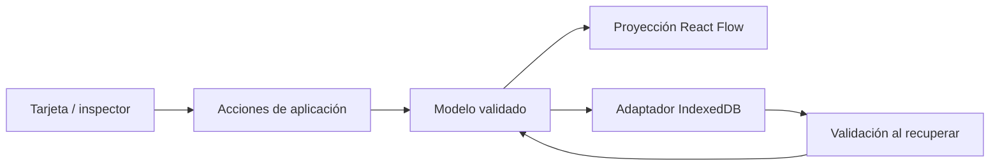

# Arquitectura de TraceBoard

## Estado y alcance
Frontend Next.js/React en apps/web y API NestJS en apps/api. IndexedDB mantiene el tablero y los binarios durables en el navegador. La API puede usar PostgreSQL o adaptadores efímeros en memoria; el despliegue actual de Railway usa memoria y no promete conservar investigaciones ni archivos después de reinicios o suspensión. Antes del prototipo no existían fuentes, configuración ni historial Git: solo skills.

## Módulos y dependencias
La funcionalidad visual está en `apps/web/src/features/investigation`. Su dominio/canvas se conserva. `apps/api/src/features/investigations` contiene dominio, casos de uso, puerto de repositorio, adaptador PostgreSQL y controladores de investigación.

| Área | Responsabilidad | Dependencias permitidas |
| --- | --- | --- |
| domain | Entidades, relaciones, integridad, esquema de datos | TypeScript y Zod (validación independiente del framework) |
| application | Crear/editar/eliminar entidades y relaciones; trazabilidad | domain |
| infrastructure | Persistir/cargar investigaciones, límites de almacenamiento | domain |
| presentation | React, canvas, tarjetas, inspector y adaptación de posiciones | application, domain, infrastructure en composición |
| src/app | Entrada Next.js, metadatos, estilos y composición | API pública de la funcionalidad |

No crear módulos adicionales hasta que una funcionalidad tenga responsabilidad propia. Los componentes de presentación pueden reutilizarse dentro de la slice sin un módulo shared prematuro. `index.ts` expone la entrada pública; los imports externos no acceden a capas internas.

## Modelo y flujo
Una investigación contiene entidades permanentes, relaciones semánticas, elementos visuales y viewport por separado. React Flow recibe una proyección; sus IDs se prefijan y nunca se persisten como IDs de entidades. Mover una tarjeta cambia su posición, no su significado. Eliminar una entidad elimina relaciones y posición asociadas.

Hay doce tipos de entidad agrupados en fuentes, análisis, negocio y solución. Los requisitos, actores, problemas, reglas, preguntas y decisiones tienen atributos propios validados por tipo; RF, RNF, RN y DEC son códigos únicos dentro de la investigación. Ver ADR-008.

La categoría opcional de relación `metadata.categoria=flujo` adapta la lectura del canvas: rutas ortogonales y puertos superior/inferior cuando el destino está en una fila inferior; `related_to` se presenta como «Continúa». No cambia el tipo de relación ni añade dependencia al dominio. El inspector conserva el tipo semántico y su descripción. Las demás relaciones mantienen su proyección habitual.



El estado de dominio se mantiene en React en el punto de composición. No se necesita Zustand para este prototipo. El almacenamiento se valida antes de hidratar; errores de cuota o datos inválidos se muestran y no se presentan como guardado correcto. El viewport se conserva junto con posiciones. Los cambios se guardan con debounce en IndexedDB, confirmando Guardado local cuando termina la transacción más reciente. Se recuperan tableros anteriores de localStorage cuando no existe una copia nueva, sin modificar ni eliminar el original. Los intentos de guardar al ocultar/cerrar la pestaña no garantizan completar la escritura asíncrona durante el cierre.

## Historial de sesión
`application/history.ts` contiene funciones puras para deshacer/rehacer; `presentation/use-board-history.ts` mantiene un historial independiente por investigación. Se retienen hasta 50 acciones mediante snapshots inmutables con payloads compartidos, sin clonar los adjuntos base64. Un arrastre, incluso múltiple, se registra como una acción; zoom, paneo y selección no consumen historial. Deshacer conserva el viewport actual y restaura entidades, relaciones, posiciones y adjuntos. Una nueva modificación descarta la rama de rehacer. El historial es de sesión y no se persiste; el resultado de cada acción sí usa el autoguardado normal. Ver ADR-002.

## Separación frontend/backend para Etapa 2
Por instrucción del usuario, al implementar el backend la estructura será:

```text
apps/web/             Next.js, React y canvas
apps/api/             NestJS, casos de uso, API y persistencia
packages/contracts/   DTO/esquemas de comunicación, solo con consumidores reales
```

Cada aplicación tiene dependencias, configuración y comandos separados. `web` se comunica mediante HTTP con `api`; no importa servicios/repositorios del backend ni accede a la base de datos. Los modelos de dominio no dependen de React o NestJS. No compartir entidades ORM como contrato público. La migración de carpetas se realizó conservando los fuentes y los tests del frontend; quedaron archivos generados anteriores en raíz, ignorados y fuera del build nuevo.

`packages/contracts` expone DTO y esquemas Zod de creación/listado/apertura, consumidos por ambas aplicaciones. No contiene dominio, UI ni acceso SQL. La API usa un pool acotado y consultas parametrizadas, bigint identity como clave interna, UUID público, timestamptz y CHECKs de integridad. Las migraciones SQL se registran y aplican en una transacción con advisory lock. Ver ADR-003.

El explorador distingue investigaciones locales y guardadas en PostgreSQL. Crear usa POST; abrir consulta GET /:id/board y valida el grafo. Guardar en base de datos envía PUT con contenido sin binarios/URLs y revisión esperada. UPDATE condicionado incrementa la revisión y actualiza JSONB/fecha en una operación atómica; revisión obsoleta devuelve 409. Integridad del grafo en dominio de API, restricciones de forma/tamaño en el contrato HTTP. Contratos no contienen reglas de negocio, componentes ni acceso SQL. El tipo de contenido es datos puros y el dominio de API puede consumir su tipo sin depender de frameworks.

Antes de reemplazar un tablero diferente se persiste una copia del borrador con ID nuevo y sin vínculo remoto. Si no cabe/no se puede escribir, se bloquea la apertura. La huella SHA-256 canónica compara contenido ignorando orden de claves JSONB y URLs locales. La revisión/huella confirmadas se conservan al deshacer; abrir contenido remoto reinicia historial. La respuesta de un guardado actualiza solo la revisión/huella del tablero correspondiente; conserva ediciones realizadas durante la petición. Importar una copia quita el vínculo remoto. Archivos recuperados en otra sesión muestran metadatos y no simulan descargar el original. Ver ADR-004.

No se borran ni suben automáticamente los tableros exclusivamente locales. La API no tiene autenticación y escucha solo en loopback. Originales Office y una política de acceso siguen pendientes.

## Archivos remotos
En la slice investigations de API, domain/file valida nombres/tipos/firmas/límites como datos y Uint8Array, sin Buffer/Nest/pg. application/files recibe un puerto para almacenamiento; infrastructure/postgres-files guarda metadata+bytea de forma atómica, con deduplicación inmutable por investigación/nombre/SHA-256. El controlador adapta cuerpos binarios y respuestas StreamableFile. PostgreSQL relaciona archivos con investigación mediante FK/índice único; el adaptador de tableros valida pertenencia y metadatos de cada referencia antes de su UPDATE. No se eliminan archivos, de modo que esa validación no compite con un borrado entre SELECT y UPDATE.

El contrato de tablero solo añade asset.file={id,sha256}, no bytes ni URL. El modelo local usa remoteFile con investigación de origen; presentación deriva URLs únicamente hacia la API. remote-files.ts sube secuencialmente, valida confirmación y mantiene URL local; después el snapshot se confirma con revisión. La confirmación actualiza vínculos solo de los adjuntos del snapshot que siguen presentes sin cambios; conserva ediciones concurrentes del usuario. Si falla el PUT, el archivo subido puede permanecer sin referencia, pero un reintento reutiliza la misma copia. Las vistas remotas descargan/verifican MIME/tamaño/hash al abrir y revocan sus Blob URLs al cerrar. Ver ADR-005.

Los scripts de desarrollo crean una instancia PostgreSQL dedicada al proyecto, con datos en .local y roles/credenciales separados. Los tests de integración usan traceboard_test, no la base de trabajo; las copias originales locales y las bases existentes del equipo no se modifican.

## Generación de flujo con IA
`apps/api/src/features/ai-flow` es independiente de `investigations`: no conoce su dominio ni persiste nada. `domain/flow-generation` valida el documento (PDF con texto, .txt o .md, hasta 10 MB) y la respuesta del modelo contra el contrato compartido; `application/generate-flow` orquesta texto → prompt → modelo sin acoplarse a una librería o proveedor concreto (`DocumentTextPort`, `FlowModelPort`); `infrastructure` implementa esos puertos con `pdf-parse` y el endpoint compatible con chat completions de Hugging Face Inference Providers (capa gratuita, modelo configurable por `HF_MODEL`). `POST /api/ai/generate-flow` exige el mismo `TRACEBOARD_API_TOKEN`; sin `HF_API_TOKEN` configurado responde 503 y el resto de la API no se ve afectado.

En el frontend, `ai-generate-dialog.tsx` sube el documento, muestra el flujo propuesto con una casilla por entidad (todas aceptadas por defecto) y solo arma relaciones entre entidades aceptadas. `application/mergeGeneratedFlow` reutiliza los mismos valores por defecto y validaciones que crear una tarjeta a mano, en una sola acción de deshacer/rehacer; las relaciones de secuencia se marcan `metadata.categoria=flujo` para la proyección ortogonal ya existente. No hay persistencia remota de la propuesta: igual que cualquier otra edición, el alta pasa por el autoguardado local habitual. Ver ADR-009.

## Despliegue Netlify y Railway

Netlify ejecuta Next.js y sus Route Handlers `/api/investigations` y `/api/ai` como proxy del backend, compartiendo la misma lógica de reenvío (`apps/web/src/app/api/http-proxy.ts`). `TRACEBOARD_API_URL` y `TRACEBOARD_API_TOKEN` son variables exclusivas del servidor; no usan prefijo público ni se incorporan al bundle del navegador. Railway valida el mismo token antes de sus controladores de investigación y de IA, y deja público únicamente `/api/health`.

Railway usa `TRACEBOARD_STORAGE=memory`, `HOST=0.0.0.0`, una réplica y Serverless/App Sleeping. Los adaptadores de memoria implementan los mismos puertos de aplicación que PostgreSQL. Se limitan a 500 investigaciones y 50 MiB de archivos por instancia. El arranque en frío puede requerir reintento y toda copia remota es temporal; IndexedDB sigue siendo la fuente durable de esta versión. Ver ADR-007.

## Calidad y evolución
ESLint y TypeScript estricto son obligatorios. `check:architecture` verifica imports con el AST de TypeScript, incluyendo imports dinámicos/reexports, capas y API pública; sus limitaciones se documentan en el script. Vitest cubre integridad, acciones, trazabilidad y persistencia. Playwright cubre creación/edición/recarga y relaciones si el navegador está disponible. Las entregas frontend/backend para GitHub incluyen CI de calidad y control de secretos; su ejecución real se registra en GITHUB-VERIFICATION.md. No se configuró protección de ramas remotas.

Por decisión del usuario se publican repositorios Git separados, conservando este workspace de desarrollo. Cada entrega incluye solo su app y el snapshot de contratos identificado por SHA-256; los cambios de comunicación requieren sincronizar ambas. Ver ADR-006 y GITHUB.md.

Migrar incrementalmente: extraer otro módulo cuando aparezca una responsabilidad real, introducir un puerto de persistencia cuando exista un segundo adaptador/backend, añadir ADR al cambiar límites, formato persistido o motor visual. Mantener pruebas de comportamiento durante esas migraciones.
